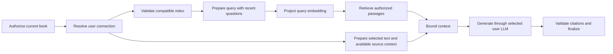

# Phase 6: AI book assistant

Phase 6 supersedes the inactive Phase 5 deployment. Reading remains available without AI credentials. Selection assistance requires a validated **user-owned LLM connection**. Book Q&A additionally requires centrally configured embeddings and a complete compatible index. No project-funded chat fallback exists.

## Setup

Use Node 24 (minimum 22.19), the pinned pnpm version, and the existing Docker infrastructure. PostgreSQL 17 includes pgvector 0.8.1 through `infra/postgres/Dockerfile`. Keep existing database volumes.

```sh
pnpm install --frozen-lockfile
node scripts/setup-env.mjs
# For an existing installation that predates encryption:
node scripts/setup-ai-key.mjs
pnpm db:up
pnpm db:migrate
pnpm dev
```

The key helper writes a random AES key to the ignored API `.env`, preserves existing keys, and never prints secrets. Restart the API after changing environment settings. Back up encryption keys separately from database backups. In production, inject keys from a secret manager; do not use the local helper as a key-management service.

1. Set `AI_ENABLED=true`, `AI_PROVIDER=user`, `RAG_ENABLED=true`.
2. Set `AI_ENCRYPTION_KEYS` to a JSON object of version names to base64-encoded 32-byte keys; set `AI_ENCRYPTION_KEY_VERSION` to the current version. Empty `{}` permits startup but disables connections. For rotation, retain old versions, choose a new current version, and replace/re-save connections to re-encrypt them. Do not discard old versions before all referenced credentials have been rotated.
3. Set `PROJECT_EMBEDDING_API_KEY` to the project's OpenAI credential. It is never read from user connections or exposed to the SPA. Without it, preparation and retrieval are unavailable while supported selection assistance continues.
4. Sign in, open **AI Settings**, add a connection, discover models or enter an exact provider identifier, and explicitly validate it. Validation makes one small user-funded request. Discovered identifiers are not considered compatible until validation succeeds.
5. Select text for assistance, or open the AI panel and select **Prepare book for AI**. Preparation requires explicit disclosure acceptance in the UI. When ready, ask questions about the current book. Only relevant excerpts and bounded history go to the selected LLM.

The example environment contains placeholders only. The application makes no AI requests at startup, except resuming an explicitly queued indexing job when project embedding configuration is available. No live credentials are included in the repository.

### Provider support

| Connection        | LangChain integration    | Models and transport                                                                                                                                               |
| ----------------- | ------------------------ | ------------------------------------------------------------------------------------------------------------------------------------------------------------------ |
| OpenAI            | `ChatOpenAI`             | Native Chat Completions-compatible text models; discovery through `/v1/models`, then validation. Responses-only models/tools are not implemented.                  |
| Anthropic Claude  | `ChatAnthropic`          | Native Messages API; model discovery, then validation.                                                                                                             |
| Google Gemini     | `ChatGoogleGenerativeAI` | Native Gemini API at its fixed official host; discovery filters `generateContent`, then validation.                                                                |
| Ollama            | `ChatOllama`             | `/api/tags` discovery and native chat protocol; the LangChain integration internally uses Ollama's streaming protocol even when the UI buffers a completed answer. |
| OpenAI-compatible | `ChatOpenAI`             | Configurable base URL, optional key, `/models` discovery when supported, otherwise manual identifiers; completed or streaming Chat Completions.                    |

These are implemented protocols, not a claim that every open-source or reasoning model is compatible. No chat model identifiers are hardcoded. A connection can validate several models; its default and saved preference affect subsequent requests only. Each answer records the actual provider/model returned by the adapter where available, otherwise the requested identifier. Context/output limits may need lowering for smaller self-hosted models. No automatic provider or model switching occurs.

For local Ollama, an administrator may explicitly set `AI_ALLOWED_PRIVATE_ORIGINS=http://localhost:11434`. `localhost` is the **NestJS host**, not necessarily the reader's laptop. Custom remote URLs require HTTPS. Private access is allowed only for exact configured origins; metadata/link-local addresses remain blocked. Every custom request resolves all DNS addresses, rejects forbidden addresses, pins the allowed address for the socket, rejects redirects and cross-origin destinations, applies timeouts, and limits responses to 2 MiB. Changing the endpoint requires explicitly replacing or clearing its key. Keyless trusted endpoints need no dummy credential.

Native Gemini uses a fixed official endpoint because its SDK does not expose the same custom fetch transport. It is never used for custom URLs. Requests receive cancellation/timeouts and output limits; generated content is bounded. The transport response-size guard applies to custom endpoints and the adapters that expose custom fetch.

Official references checked for the pinned packages: [LangChain OpenAI](https://docs.langchain.com/oss/javascript/integrations/chat/openai), [Anthropic](https://docs.langchain.com/oss/javascript/integrations/chat/anthropic), [Gemini](https://docs.langchain.com/oss/javascript/integrations/chat/google_generative_ai), [Ollama](https://docs.langchain.com/oss/javascript/integrations/chat/ollama), [LangGraph](https://docs.langchain.com/oss/javascript/langgraph/graph-api).

## Project embeddings and indexing

This deployment deliberately supports one embedding configuration: **OpenAI `text-embedding-3-small`**, default **1536 dimensions**, cosine similarity. Dimensions can be centrally reduced within 1–1536. Both documents and queries use the same native adapter, model, dimensions and configuration version. No asymmetric instruction prefix is required for this model. `cl100k_base` measures actual embedding input tokens; the 600-token default chunks stay below the model's 8192-token limit. [OpenAI embedding guide](https://developers.openai.com/api/docs/guides/embeddings)

`PROJECT_EMBEDDING_VERSION` must change when replacing the embedding space. A SHA-256 configuration identity also includes provider/model, dimensions, endpoint, extraction version, chunking version, chunk size and overlap. Chat-model changes are excluded from this identity. An unsupported embedding provider/model fails configuration validation, rather than silently substituting a model.

| Configuration                                    | Default                                                                                 |
| ------------------------------------------------ | --------------------------------------------------------------------------------------- |
| `PROJECT_EMBEDDING_VERSION`                      | `openai-small-v1`                                                                       |
| `EMBEDDING_BATCH_SIZE`                           | 16 chunks, maximum 64                                                                   |
| `INDEX_CONCURRENCY`                              | 1 active run across API instances, maximum 4; each instance processes one run at a time |
| `INDEX_MAX_MB` / `INDEX_MAX_PAGES`               | 50 MiB / 2000 pages                                                                     |
| `INDEX_MAX_EXTRACTED_BYTES` / `INDEX_MAX_CHUNKS` | 10,000,000 UTF-8 bytes / 30,000 chunks                                                  |
| `RAG_CHUNK_TOKENS` / `RAG_OVERLAP_TOKENS`        | 600 / 80 cl100k tokens                                                                  |
| `RAG_MIN_SCORE`                                  | 0.25 cosine threshold; calibrate on representative books                                |
| `AI_TIMEOUT_MS`                                  | 60 seconds per provider request                                                         |
| `AI_MAX_INPUT_BYTES` / `AI_MAX_OUTPUT_TOKENS`    | 24,000 UTF-8 bytes / 2048 output tokens                                                 |

Indexing is an explicit, durable PostgreSQL job, using the existing API process and private storage. It does not run on upload. A lease and database advisory lock prevent duplicate active jobs and bound workers across instances. Each page and embedding batch commits separately; there is no database transaction spanning a provider call. A restarted worker claims expired leases and skips committed pages/vectors. Transient network/server errors get at most two automatic retries with backoff. Credentials/quota failures require explicit retry. Cancelling clears the lease; every write and final activation checks that lease and a ready owned book.

PDF.js extraction runs in a separate local process with a 256-MiB V8 heap cap and 30-second load/page deadlines, without application credentials. This isolates native PDF dependencies and keeps parsing off the HTTP event loop. Deployment/container memory limits should also bound native allocations. Source deletion or cancellation is checked between pages and by heartbeat. No OCR, remote PDF assets, or image understanding runs.

Extraction visits every page. Text items are concatenated with a newline for `hasEOL` and a space otherwise. Chunk offsets are **UTF-16 indices into that exact stored extracted page text**, not PDF byte offsets. Page numbers are **one-based**. The chunker preserves supplied paragraph breaks when present, splits long spans deterministically, and overlaps using tokens. Chunks deliberately stay within one page, so every chunk has an explicit page-specific source span and no ambiguous cross-page offset. Stable identities include the document/configuration identity, page, offsets and content.

Processing and coverage are independent. The UI reports pages processed/chunks embedded plus text pages, no-text pages, failed pages and limitations. A page without extracted text may be blank or scanned. Mixed documents disclose extracted-text-only coverage; wholly scanned documents fail with an OCR explanation. Any failed extraction or whole-book limit prevents activation. A failed/cancelled run retains completed derived work for explicit resumption. It never claims that only an initial part of a book is fully indexed.

Remote success followed by a crash before committing its vector batch can require repeating that uncommitted batch. Committed batches are reused. Unknown incurred usage is retained conservatively; the application cannot promise exactly-once external embedding billing.

## Persistence, authorization and retrieval

TypeORM entities and three Phase 6 versioned migrations add:

- `ai_connections`, `ai_preferences`: owner-scoped named connections, authenticated ciphertext, masked suffixes, validation/model preferences.
- `ai_indexes`, `ai_runs`: immutable document/configuration identities, ready/active state, leases, attempts, progress and coverage.
- `ai_pages`, `ai_chunks`: owner/book/index relationships, normalized page text, stable chunk IDs, token lengths, source spans and pgvector vectors.
- `ai_conversations`, `ai_messages`: user/book conversations, request idempotency hashes, question/answer pairs, selections, validated citations, actual provider/model, usage and terminal/partial state.
- `ai_usage`: separate page reservations, document embeddings, query embeddings and user-funded generation; nullable provider-reported token counts and durations. No invented costs.

`synchronize: false` remains set. Owner/book composite foreign keys and vector-dimension validation reinforce service authorization. Document version is the existing immutable upload/book UUID; changing a PDF means a new uploaded document. Credentials are encrypted with AES-256-GCM, random IVs and authenticated owner/connection/key-version binding. Queries do not select ciphertext by default, and API views expose only a suffix. No keys enter graphs, browser storage, URLs, checkpoints or logs.

The current retrieval strategy is **exact cosine search after database scope filters**, using a B-tree scope index and pgvector distance operators. This avoids approximate-index recall loss under narrow owner/book filters at the bounded per-book scale. Each SQL query applies owner, book, exact document version, explicit index, active/ready status and embedding configuration/dimensions **inside the query**. Parameterized SQL is used for vectors and identifiers. Empty or missing scopes fail; model output never determines scope. Similarity thresholding happens only after authorized retrieval. [pgvector search and filtering](https://github.com/pgvector/pgvector#filtering)

Vector columns are dimension-flexible to retain different historical configuration versions, while a database trigger enforces the exact index dimension for each stored vector. No HNSW/IVFFlat index is installed: introducing one requires measured recall under these filters and an expression/partition strategy for the chosen dimensions. Increasing limits beyond the current book scope should include load testing.

Replacement indexes are separate records. Only successful completion atomically activates a replacement; incompatible old vectors never receive a new-model query. Setting a book to a non-ready/deleting state immediately deactivates retrieval, cancels jobs/messages, releases unused page reservations and prevents lease writes. Foreign-key cascades remove derived pages/chunks/vectors/conversations after source deletion. Workers cannot recreate deleted parents.

## Workflows, grounding and cancellation

`AssistantWorkflow` uses a fixed LangGraph sequence:



Graph state holds identity, authorized scope, action/question, source context, passages/references, response and error. Credentials are resolved inside provider adapters from trusted owner/connection references. There are no agents, model-selected tools, external traces or persistent checkpoints. `LANGSMITH_TRACING`, `LANGCHAIN_TRACING_V2`, `LANGCHAIN_TRACING`, and `LANGCHAIN_VERBOSE` must stay false; enabling them fails startup. The earlier Phase 5 disabled graph implementations remain unregistered foundation examples/tests.

Selection assistance does not embed anything. The bounded context builder verifies ownership, document version and annotation/geometry relationships. Browser selections remain explicitly unverified. Where an active, authorized extracted page contains the selection, bounded surrounding text can be loaded from the database; otherwise it is omitted with a limitation. User notes are separate untrusted content. Application instructions, source labels and boundary structures reduce accidental instruction mixing; they do not eliminate prompt injection.

Book queries include at most two recent user questions for deterministic follow-up retrieval; there is no paid query rewriting. Generation history includes at most four completed question/answer pairs, dropping oldest pairs to fit a 6000-byte/quarter-input-budget limit. Retrieved context is at most 12,000 bytes within the total budget; the primary selection is rejected rather than silently changed when it cannot fit. UTF-8 byte limits conservatively bound unknown chat tokenizers; they are not represented as measured model tokens.

Sources get backend `S1`… identifiers. Only supplied identifiers become persisted, clickable citations. Unknown citation markers are removed. No passages, or an uncited book answer, yields the explicit insufficient-evidence response. Citation membership is not semantic entailment: a model can still attach a real source to an unsupported statement. The UI labels AI content, distinguishes the original browser passage, and renders Markdown without raw HTML, remote images or provider-created links. Reliable selection geometry reuses existing PDF coordinate navigation; retrieved page text uses page navigation without invented rectangles. Examples are prompted to identify themselves as illustrative.

The authenticated CSRF-protected POST returns NDJSON status/text/result events. Streamed text is provisional until the validated terminal result; only final backend citations are navigable. Non-streaming connections buffer the provider result. Request UUIDs are unique per owner and hash-checked: replay returns the saved record rather than making another paid request. There is one pending message per conversation, no automatic generation retries, and no recovery-driven paid restart. Client disconnect, explicit cancellation, removed/replaced connection, deletion and timeouts propagate abort where supported. Partial responses and output-limit stops are marked incomplete. Stale pending messages become failed/incomplete after five minutes and require explicit retry. Cancellation cannot reverse charges already incurred.

Full-book summaries, exhaustive occurrence listings, OCR, image questions and autonomous tools are outside this implementation. The complete extracted book is indexed, but generation sees only the selected relevant passages. The UI and system instructions disclose this limitation.

## Quotas and operational limits

Per-user reservations use a PostgreSQL advisory transaction lock; concurrent calls cannot bypass daily quota checks. Defaults reset at UTC day boundaries:

| Usage                           | Daily default           |
| ------------------------------- | ----------------------- |
| Index page reservations         | 2000 pages              |
| Document embedding input budget | 2,000,000 cl100k tokens |
| Query embeddings                | 100 requests            |
| User LLM generation/validation  | 100 requests            |

There are at most two queued/processing books per user, two concurrent LLM requests, and ten new LLM attempts per minute. Existing API authentication/CSRF/throttling applies as well. Page reservations release unprocessed pages on cancellation/final failure; explicit retry atomically reserves remaining capacity. Provider calls that might have incurred charges retain their request/input budget on error. Calls never started release reservations, including evidence-only abstention. Actual provider-reported tokens are stored separately and stay null when unavailable; token budgets are not billed cost claims. Stale started requests are reconciled as failed with conservative reservations.

## Notebook integration

This repository has highlights, attached notes and standalone **book notes**, but no independent notebook/notebook-entry feature or deletion-preserving notebook contract. This phase does not rebuild notes into notebooks. A later notebook save operation should copy a completed answer's question, answer, persisted citations, provider/model and timestamp into a distinct AI-generated entry, independently of the source book/conversation. Existing annotation and note deletion rules remain unchanged.

## Verification and evaluation

```sh
pnpm build
pnpm typecheck
pnpm test
pnpm test:ui
```

Tests require local PostgreSQL/pgvector and private test storage, not AI credentials. Generate PDF fixtures with `pnpm fixtures` once. API tests exercise real ownership, encrypted persistence, atomic quotas, indexing leases/resumption/cancellation, vector SQL, immutable versions, conversations and citations with **test-only** embedding/generation adapters. Native LangChain adapters are separately exercised using HTTP fixtures for all five protocols. Real PDF extraction covers beginning/middle/end and an image-only scan. Browser tests cover settings, explicit validation, disabled capabilities, preserved selections, model switching, safe Markdown, citations, the mobile Drawer and existing reading/annotation workflows.

The small deterministic grounding set covers Violet Valley on the first page, Amber Ocean in the middle, Silver Moon on the final page, a contextual follow-up and an unsupported football question. Checks include expected page retrieval, source-supported answer content, retained follow-up context and abstention. These fixture results validate routing/scoping/grounding mechanics, **not real-model answer quality**. Before production, run a larger representative book set, manually check claim-to-source support and false abstentions, and calibrate `RAG_MIN_SCORE`.

Live verification is explicitly opt-in: set `AI_LIVE_TEST=I_ACCEPT_PROVIDER_CHARGES`, `AI_TEST_PROVIDER`, `AI_TEST_MODEL`, and `AI_TEST_API_KEY` (optional for trusted keyless protocols). Custom protocols additionally need `AI_TEST_BASE_URL`; private origins need `AI_TEST_PRIVATE_ORIGINS`. Set `AI_TEST_STREAMING=true` to test streaming, then run `pnpm --filter ./apps/api test --testPathPatterns=ai-live`. This uses only these explicit test credentials, sends a tiny validation request and does not use ambient project credentials. **No live provider was verified during implementation.** See [API reference](ai-api.md) and [completion report](phase6-report.md).
