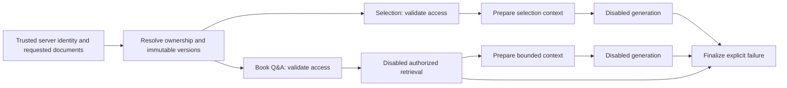

# Phase 5: internal AI and RAG foundation

Phase 5 adds contracts, bounded context preparation, deterministic supplied-text chunking and two internal LangGraph workflows. It does **not** enable AI for users. There are no model SDK integrations, model calls, embeddings, indexing jobs, vector searches, streaming routes, AI controls, tools, autonomous agents or persistent graph checkpoints. Existing reader and annotation behavior is unchanged. No notebook feature exists in this repository.

## Responsibilities and code boundaries

| Component                          | Responsibility                                                                                                                                |
| ---------------------------------- | --------------------------------------------------------------------------------------------------------------------------------------------- |
| NestJS `AiModule`                  | Dependency injection, validated configuration, internal context/workflow services and authenticated capabilities                              |
| `providers.ts`                     | Provider-independent generation, streaming, embedding and passage-retrieval interfaces with explicit `Symbol` tokens                          |
| `disabled.providers.ts`            | Only production adapters: generation rejects with `AI_DISABLED`; embedding/retrieval reject with `RAG_DISABLED`                               |
| LangChain Core (`@langchain/core`) | Foundation dependency for future prompt construction, model/embedding integrations and retrieval adapters; no live provider package installed |
| LangGraph (`@langchain/langgraph`) | Fixed context/retrieval/generation/finalization paths behind the `AiWorkflows` interface and `AI_WORKFLOWS` token                             |
| PostgreSQL + pgvector              | Extension availability only in this phase; future vector persistence and filtered similarity search                                           |
| TypeORM                            | Existing entities, owner-scoped repository services and versioned migrations; `synchronize: false` remains mandatory                          |
| `contracts.ts` / web `ai/types.ts` | Dependency-free transport types reused by frontend through type-only exports; no backend runtime or secrets bundled                           |

The dependency versions are recorded in the API package and pnpm lockfile (Core 1.2.17 and LangGraph 1.5.0 at implementation). `@langchain/core` supplies the required LangChain primitives without introducing the umbrella agent package. No providers return fabricated answers outside tests.

## Configuration and capabilities

Configuration is validated at startup by `validateEnvironment` and the AI configuration provider. Existing `.env` files need no new values: omitted settings use these defaults. Enabling either flag, selecting another provider, enabling tracing, or invalid limits fails startup clearly. No model credentials are required.

| Variable                       | Default     | Meaning                                                            |
| ------------------------------ | ----------- | ------------------------------------------------------------------ |
| `AI_ENABLED`                   | `false`     | Must remain false                                                  |
| `AI_PROVIDER`                  | `disabled`  | Only supported adapter configuration                               |
| `RAG_ENABLED`                  | `false`     | Must remain false                                                  |
| `AI_CONTEXT_SELECTION_CHARS`   | `10000`     | Primary selection, reject overflow                                 |
| `AI_CONTEXT_SURROUNDING_CHARS` | `4000`      | Optional authorized surrounding/retrieved excerpts, combined limit |
| `AI_CONTEXT_QUESTION_CHARS`    | `2000`      | User question, reject overflow                                     |
| `AI_CONTEXT_NOTE_CHARS`        | `5000`      | Optional personal note, truncate with limitation                   |
| `AI_CONTEXT_TOTAL_CHARS`       | `24000`     | Instructions + selection/excerpts + question + personal notes      |
| `RAG_CHUNK_CHARS`              | `1600`      | Maximum supplied-text chunk size                                   |
| `RAG_CHUNK_OVERLAP_CHARS`      | `200`       | Maximum overlap; strictly below chunk size                         |
| `LANGSMITH_TRACING`            | unset/false | External tracing forbidden                                         |
| `LANGCHAIN_TRACING_V2`         | unset/false | External tracing forbidden                                         |
| `LANGCHAIN_TRACING`            | unset/false | Legacy tracing forbidden                                           |
| `LANGCHAIN_VERBOSE`            | unset/false | Private-context console tracing forbidden                          |

Limits are **UTF-16 code units, not tokens**. They are finite integers capped at 1,000,000; chunk size is at least 2, and optional note/surrounding/overlap limits permit zero. The total counts content strings, not serialized source metadata or model-specific framing. Phase 6 must count the fully rendered prompt against the selected model's tokenizer, including metadata, before sending it. The internal workflow output-token parameter is a positive integer capped at 32,768; the real provider/model limit will also apply in Phase 6. Language is a bounded language tag such as `en`, `ur` or `ur-PK`.

`GET /api/ai/capabilities` is the only new HTTP endpoint. It uses the existing session cookie `AuthGuard`, returns 401 without a session, inherits the existing rate limit and `Cache-Control: no-store`, and returns:

```json
{
  "generation": false,
  "streaming": false,
  "embeddings": false,
  "retrieval": false,
  "reason": "PHASE_5_DISABLED"
}
```

Swagger documents this at `/api/docs` and `/api/docs-json`. No provider configuration, keys, passages or model details are exposed. The frontend does not call this endpoint or render AI controls. There are no public generation, graph, indexing or retrieval routes.

## Internal workflows and authorization



`selection(userId, input, options)` and `bookQa(userId, documents, question, options)` accept server-supplied identity separately. They call `BooksService.owned` before constructing/invoking a graph, copy/freeze the authorized scope, and recheck access in the validation node and immediately before generation. Empty document scope is rejected; it never means all books. The Q&A scope is limited to 20 explicit documents. No model receives the authority to select documents, rewrite graph state or call tools. Only backend nodes write state, and generation can return only content/status/usage.

The typed graph state includes request/user identity, authorized document scope, action, question, prepared context, retrieved passages, source references, response, safe error/status and executed steps. Selection actions are `EXPLAIN`, `GIVE_EXAMPLE`, `TRANSLATE`, `ASK_FOLLOWUP`; `ASK_BOOK` distinguishes the future Q&A workflow. Failure edges finalize without running subsequent provider nodes. Default selection invocation ends in `AI_DISABLED`; default Q&A invocation ends in `RAG_DISABLED` before context/generation. Tests alone inject successful fixture adapters to exercise those later transitions.

Graphs are private to the implementation, compiled without checkpointers, invoked without caller callbacks and never connected to controllers or background jobs. Tracing settings are also checked immediately before workflow execution. Do not wrap these workflows in external trace collectors or add callbacks carrying graph state. Never log prompts, passages, notes, graph state, provider credentials or raw provider exceptions. Known errors contain fixed messages; unexpected node failures are replaced with a safe generic error. Cancellation propagates through `AbortSignal` into LangGraph and provider/retrieval contracts. Cancellation before or between graph steps can reject with typed `CANCELLED`; provider cancellation can finalize with cancelled status.

## Context, provenance and citations

`ReadingContextService.prepare` reuses `BooksService.owned` and `AnnotationsService.get`, which use existing TypeORM repositories with owner/book filters. It does not query another owner's resource first and authorize afterward. An annotation must match its route book; a highlight must also match immutable version, selected text, pages and supplied geometry. Pages are **one-based**. Geometry reuses annotation coordinate version 2: PDF user-space rectangles, bottom-left origin, before rotation. Bounds are checked against existing `pageBoxes`; missing geometry causes anchored requests to fail without downloading the PDF. Selection references include their own book/version binding.

The immutable document version is the uploaded **book UUID**, as in Phase 4. PDFs cannot be replaced in place; rename does not change the version. A future replacement feature must mint a new immutable version and invalidate derived data. Standalone book notes have no document anchors and retain a null document version in their personal-note reference.

Application instructions, questions, book excerpts, personal notes and reserved conversation history are separate fields. Context passages carry source labels, `UNTRUSTED_CONTENT`, origin and verification status. Browser selections remain `CLIENT` / `BROWSER_SELECTION` / `verifiedDocumentText: false`, including when matching a saved highlight. Storing browser text in the database does not verify it against the PDF. Attached notes are loaded from the database and labeled `USER_AUTHORED`, not original book text or instructions. Titles and saved anchors come from authorized database resources; no titles, pages or rectangles are invented.

There is no authorized extracted-page store yet. Selection context therefore omits surrounding text and records `SURROUNDING_TEXT_UNAVAILABLE`; it never downloads/extracts an entire book for a selection. Primary selection/question and total mandatory-text overflow are rejected, not shortened. Optional notes are bounded and record `PERSONAL_NOTE_TRUNCATED`. The future Q&A preparation node bounds authorized retrieved excerpts and records `SURROUNDING_TEXT_TRUNCATED`. The shared optional-text helper avoids cutting surrogate pairs.

These boundaries support safer prompt construction; they do **not** eliminate prompt injection. Future LangChain prompt adapters must preserve role separation, delimit untrusted material and use fixed application instructions. Do not interpolate excerpts into system instructions or parse document instructions as authorization or tool commands.

`SourceReference` distinguishes `BOOK_TEXT`, `PERSONAL_NOTE` and future `AI_GENERATED` content. Source inclusion is not proof for every generated claim. Phase 6 must attach claim-specific citations and validate each against actually supplied authorized passages. `CitationNavigation` can drive existing reader page/annotation navigation after reauthorization. Missing, unauthorized, version-mismatched or unpaged sources are explicitly unavailable. The current reader offers Return to library for a missing book. There is no established notebook deletion behavior to reuse: a future notebook should retain its permitted authored entry, mark a deleted source unavailable and disable source navigation, without inventing a location. Notebook-entry inputs currently fail with `NOTEBOOKS_UNAVAILABLE`; implementing notebook persistence/UI is deferred.

## Deterministic chunking

`chunkPageText(document, versions, pages, config)` is a pure, manually invoked utility. It has no database, storage, upload, job, embedding or network connection. Input pages must have distinct increasing one-based numbers; gaps and empty pages are allowed. It makes page-local chunks, preferring the last blank-line paragraph boundary fitting a size window, then splits oversized paragraphs predictably. Overlap is at most the configured number of code units and never crosses a page. A boundary that would prevent forward progress is not used. Valid surrogate pairs are never split; combining sequences may span chunks.

No normalization or trimming changes the supplied text. Whitespace-only chunks are omitted; each emitted chunk contains the exact original substring. Half-open `start`/`end` offsets refer to that page's original UTF-16 text. Extraction that changes whitespace must declare a new extraction version and preserve its own mapping to the PDF. Chunk SHA-256 identities include book/version, extraction/chunking versions, size/overlap, page/span and exact text. They remain stable for identical input and distinguish changed processing or content. Default chunking algorithm identifier should be `page-paragraph-v1`; changing the algorithm requires a new version.

## pgvector setup and migration

Development Compose builds `infra/postgres/Dockerfile`: PostgreSQL 17 Alpine with pinned pgvector 0.8.1 compiled in a separate build stage. The final image retains the existing PostgreSQL data path and named volume. It does not create vectors or indexes. Keeping PostgreSQL's major version and Alpine preserves the existing development volume environment. The first build needs network access to Alpine packages and the pinned upstream pgvector source; application startup never needs AI network access.

```sh
pnpm db:up
pnpm db:migrate
```

Migration `EnablePgvector1791980000000` checks for the extension, then runs `CREATE EXTENSION IF NOT EXISTS vector`. Existing app records/tables are untouched. If extension binaries or permissions are missing, the migration fails transactionally with an administrator setup message instead of recording a misleading success. On hosted PostgreSQL, an administrator must enable/install the matching pgvector extension and run this in the **application database** before the regular migration role retries:

```sql
CREATE EXTENSION IF NOT EXISTS vector;
SELECT extversion FROM pg_extension WHERE extname = 'vector';
```

If the extension already exists, the migration succeeds without needing extension-creation privileges. Rollback deliberately retains the shared extension; it must not drop unrelated vector data or dependencies. No vector columns or similarity indexes are created, and no embedding dimension is selected.

## Proposed Phase 6 persistence (documentation only)

| Proposed table              | Ownership, identity and purpose                                                                                                                                                   |
| --------------------------- | --------------------------------------------------------------------------------------------------------------------------------------------------------------------------------- |
| `document_processing_runs`  | Owner + book + immutable version, extraction/chunking versions, config hash, state, safe failure code/stage, attempt timestamps. Unique processing key makes retries idempotent.  |
| `extracted_pages`           | Run + owner/book/version + page, exact text and extraction version/offset mapping. Unique run/page. Private content with deletion cascade.                                        |
| `document_chunks`           | Stable chunk ID, owner/book/version/run, page spans, exact text, chunking config/version, content hash. Composite ownership/version foreign keys.                                 |
| `embedding_indexes`         | Owner/book/version, run, provider/model/dimensions, index version, processing state, expected/stored chunk counts. Publish READY only after complete validation.                  |
| `chunk_embeddings`          | Owner/book/version/chunk + embedding-index key + provider/model/dimensions + vector. Unique index/chunk. Choose vector type/dimensions/index strategy only after model selection. |
| `conversations`, `messages` | Owner, authorized document scope/version snapshots, roles, content, claim citations, request IDs and timestamps; no cross-owner associations.                                     |
| `ai_usage`                  | Request ID, owner, action, provider/model, reported input/output tokens, duration and completion/cancellation/failure. Unknown tokens/costs remain null; no inferred charges.     |

TypeORM will own entities and migrations; LangChain adapters will implement model/embedding/prompt/retrieval boundaries. `VectorStorage` already describes owner, book, version, chunk, embedding model/dimensions and index version. Do not adopt a framework-created global vector table or a second ORM.

The future pipeline is: authorized immutable upload → extracted pages → deterministic chunks → embeddings → atomically publish complete index → authorized retrieval → sourced generation. A model/dimension, extraction, chunking or config change creates a new run/index; never mix vectors from incompatible models. Retrieval excludes STALE, incomplete, FAILED, cancelled and nonmatching indexes. Book deletion cancades processing and cascades through pages/chunks/indexes/vectors, then invalidates source navigation and caches. Conversation/notebook retention and source-deletion redaction need explicit product policy before persistence. Recheck source existence/version at final response use.

Future vector queries must enforce owner, explicit allowed book/version pairs, model/dimensions and READY index **inside SQL**, before ranking/limiting. Application checks on returned metadata are defense in depth, not a substitute. Empty scope is rejected before SQL. If TypeORM cannot express vector operations, use parameterized `QueryRunner.query` values; never interpolate question text, vector literals, user IDs, document IDs or model names. Example shape only, not executable Phase 5 code:

```sql
SELECT c.id, c.text, c.spans, e.embedding <=> $1::vector AS distance
FROM chunk_embeddings e
JOIN document_chunks c ON c.id = e.chunk_id AND c.owner_id = e.owner_id
JOIN embedding_indexes i ON i.id = e.index_id AND i.owner_id = e.owner_id
JOIN books b ON b.id = c.book_id AND b."userId" = c.owner_id
WHERE e.owner_id = $2
  AND (c.book_id, c.document_version) IN
      (SELECT book_id, document_version FROM jsonb_to_recordset($3::jsonb)
       AS scope(book_id uuid, document_version uuid))
  AND i.status = 'READY' AND i.index_version = $4
  AND i.model = $5 AND i.dimensions = $6 AND i.provider = $8
  AND b.status = 'READY'
ORDER BY distance
LIMIT $7;
```

The actual schema must enforce matching book/document version throughout the composite foreign keys. SQL and index choices require tests for multiple owners, deletion races and partial indexes before activation.

## Phase 6 request controls and verification

Before invoking a graph, the application service will enforce per-user quotas, request-rate and concurrency limits, allowed actions/models and tokenizer-based input/output limits. Provider adapters will enforce deadlines and propagate cancellation on disconnect. Retrying before provider acceptance can be safe; after acceptance/partial output, do not automatically repeat generation and risk duplicate charges. Persist request/idempotency keys and reconcile provider request IDs/usage where supported. Apply authorization before retrieval and again before disclosure, not via model decisions. No billing system or usage database is added now.

Run offline tests without PostgreSQL, AI credentials, paid services or a vector database:

```sh
pnpm --filter ./apps/api test:ai
```

Full verification additionally uses the existing local PostgreSQL, MinIO and Mailpit services:

```sh
pnpm db:migrate
pnpm test
pnpm test:ui
pnpm build
```

Offline tests exercise real AI module initialization with existing resource services replaced only in tests, blocked HTTP/fetch calls, production disabled adapters, graph transitions with test-only adapters, authorization ordering, context limits, provenance, source mismatch, scope broadening, chunk fixtures and migration failure/idempotency. Integration tests use real owner-scoped TypeORM repositories and verify authenticated capabilities/no generation routes. Browser tests assert no AI controls/requests in library, reader, selection toolbar and notes; existing reader/annotation suites remain the regression baseline. Separate notebooks cannot be regression-tested because they do not exist.

References: [LangGraph graph API](https://docs.langchain.com/oss/javascript/langgraph/graph-api), [LangGraph tracing](https://docs.langchain.com/langsmith/trace-with-langgraph), [pgvector upstream installation and Docker](https://github.com/pgvector/pgvector), [PostgreSQL CREATE EXTENSION permissions](https://www.postgresql.org/docs/17/sql-createextension.html).
